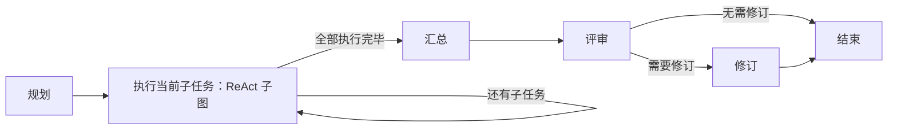

# LangGraph 旅行 Agent

功能与 `../native/` 对应，执行顺序由 LangGraph 的 `StateGraph` 管理。
模型调用继续使用 OpenAI SDK，工具继续使用普通 Python 函数；不需要额外安装 `langchain`。
`langchain-core` 等包由 `langgraph` 自动安装为依赖。

## 运行

在仓库根目录使用当前 Conda 环境：

```bash
python -m pip install -r langgraph_app/requirements.txt
python langgraph_app/agent.py
python langgraph_app/agent.py --mode react "杭州现在天气如何？"
```

或进入本目录运行 `python agent.py`。两种启动方式都读取根目录 `.env`。
默认 `hybrid`；支持 `react`、`plan`、`reflection`，命令、配置及工具说明见 [根目录说明](../README.md)。

## 三个核心概念

- **State**：当前问题、消息、工具证据、计划和答案等。节点返回部分字段，其他字段保留。
- **Node**：接收状态、完成一步工作并返回更新的 Python 函数。
- **Edge**：连接节点；条件边根据状态选择下一步。

所有图按顺序执行，列表和字典字段使用默认覆盖语义，不使用自动累加的 reducer。
工具节点先复制消息、证据和缓存，再返回更新，避免重复累加消息。
未启用检查点或跨进程恢复；图状态仅属于当前一轮，长期偏好仍写入本目录 JSON 文件。

## 文件与执行流程

| 文件 | 图的流程 |
| --- | --- |
| `agent.py` | 终端输入、模式切换、五轮历史、异常提示和统计 |
| `common.py` | 模型封装、提示词、共享 `WorkflowState`、调用图的入口 |
| `tools.py` | 天气、搜索、偏好；工具 Schema、参数和权限校验 |
| `react.py` | `prepare → model → tools → model`；模型直接回答则结束 |
| `plan_solve.py` | `plan → execute → tools/advance → execute`；最后一步回答 |
| `reflection.py` | ReAct 子图得到初稿，再运行 `review → refine → review` 子图 |
| `hybrid.py` | `plan → execute（ReAct 子图）→ summarize → reflect（评审子图）` |



每个模式的 `create_*_graph` 构建并编译图，`run_*` 只负责提供初始状态和取得答案。
图在本地进程运行，无需服务端、LangSmith 账户或额外平台。
终端的 `[LangGraph] 节点：…` 显示当前进入哪个节点。

## 保留的边界和调用上限

- ReAct 最多 6 次模型调用，最后一次不提供工具；格式错误也计入轮数。
- Plan-and-Solve 规划一次，最多执行 5 个步骤，每步只调用一次模型，最后一步无工具。
- Reflection 先运行 ReAct，再最多评审和修订 2 轮；评审或修订失败保留最近完整答案。
- Hybrid 最多 3 个子任务，每个 ReAct 子图最多 3 次模型调用，统一汇总后最多评审和修订 1 轮。
- Hybrid 中一次工具成功即可完成的步骤允许提前结束；搜索仍需模型检查结果。
- 子任务分别拥有消息和工具权限，共享本轮工具证据及天气缓存；子任务失败仍保留已取得证据供后续步骤和汇总使用。

图节点数量不等于模型调用次数：工具节点、初始化节点和推进步骤的节点不调用模型。
框架不自动减少模型请求，也不保证检索质量；工具选择、偏好提取和结果筛选仍依赖模型与提示词。

## 会话与偏好

四种模式在同一进程内共用最近五轮历史；与原生版的会话独立。
`preferences.json` 初始内容复制自原生版，之后只由本版更新。
明确的长期偏好自动保存，临时要求不保存，未变化的偏好不重复写入。
`/clear` 清空当前会话和历史工具证据，不删除偏好。天气缓存每轮重新创建。

原生版模型参数、工具接口细节见 [原生版说明](../native/README.md)。
框架资料：[图 API](https://docs.langchain.com/oss/python/langgraph/graph-api)、[子图](https://docs.langchain.com/oss/python/langgraph/use-subgraphs)。
